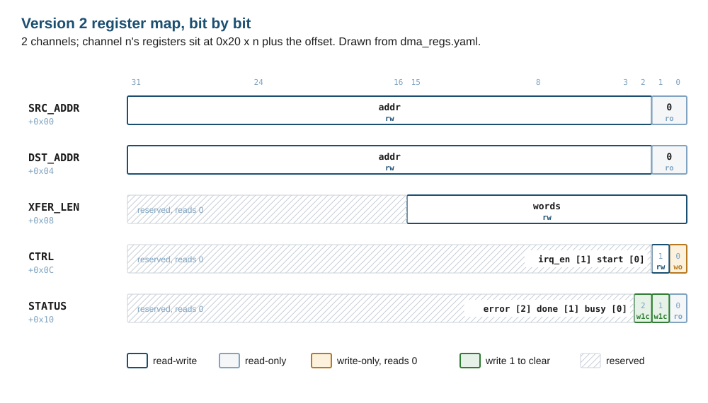

# From Architecture to Verification: a DMA Case Study {#sec-ch11}

> The testbench checks the design against a document. If there is no document, it checks the design against itself.

::: {.callout-note title="Learning objectives"}
After this chapter you can read an architecture specification as a verifier and turn its programmer's model, interfaces and promises into a black-box feature list; set a performance target by arithmetic and measure a design against it; read a microarchitecture as datapath and control and name the internal state each design decision adds; derive protocol checks from a timing diagram; write a verification plan whose rows come from both documents; draw a testbench before writing it and say what each component checks; write a coverage model off the microarchitecture; and send every hole and failure back to the plan row or the spec question it came from.
:::

## One length register, two answers {#sec-ch11-opening}

A DMA engine has a register called `XFER_LEN`. It holds the transfer length in words, it is 32 bits wide, and it is read-write. Software writes 65,536 into it, sets the start bit, and waits for the interrupt. The interrupt arrives ten cycles after the testbench began programming the registers. `STATUS` reads `DONE`, with no `ERROR`. No word has moved.

```{.text include="examples/ch11-architecture-to-verification/v1-findings/run.out" lines="1-6"}
```

The engine counts only the low sixteen bits of the register, and the low sixteen bits of 65,536 are zero. A zero-length transfer is legal, and the engine finished it correctly. Which of the two is the bug: the RTL that ignores half of a register software can write, or a register map that offers a length the counter cannot hold? Nothing in the RTL can answer that, because the RTL is one of the two parties to the disagreement. The testbench that found it did not know the RTL's counter width. It was written from what the register is, a 32-bit length in words, and its reference model expected 65,536 writes. That is the whole reason it found anything.

The engine is real. It is the DMA in the author's SystemC repository: an APB-programmed, single-channel engine with an AXI4-Lite master, a five-state state machine, a Verilog twin of its SystemC model, and a UVM-SystemC testbench [@kubavat2026systemcdma]. This chapter keeps that design byte for byte as *version 1*, and treats it the way a verification engineer treats a block that arrives with its RTL: as an answer to questions nobody wrote down. Then it writes the documents a team writes before RTL, in the order industry writes them, and builds *version 2*, a two-channel engine, from them. Version 2 is where microarchitecture decisions appear, and where the bugs they invite appear with them.

The four documents are the architecture specification, the microarchitecture specification, the verification plan, and the testbench with its coverage model. Each section of the chapter takes one of them, draws it, and shows what the next one reads from it. The figures are generated from the example files, so every number in a picture is one a simulator printed. The planning chapter's format (@sec-ch02), the ready/valid vocabulary of the digital-design chapter (@sec-ch03-interfaces), the constrained-random stimulus of @sec-ch07 and the covergroups of @sec-ch08 all come back here, on one design larger than the FIFO.

## Reading the architecture spec as a verifier {#sec-ch11-arch}

An architecture specification says what a block does as seen from outside it: the function, the programmer's model, the interfaces and their protocols, and the performance it promises. A verifier reads it *black-box*. Every sentence in it is a candidate plan row, because every sentence describes something a user of the block could observe and complain about.

::: {.callout-note title="Definition"}
In this book, the **architecture** of a block is everything observable at its boundary: registers and their access rules, interface signals and protocols, function, errors, and performance. Two designs with the same architecture are interchangeable to software and to the rest of the chip. The **microarchitecture** is one way to build it: the datapath, the state machines, the FIFOs and arbiters, the latency of each operation. A verifier reads the architecture black-box, for what a user can see, and the microarchitecture white-box, for the internal states and corner cases a user cannot see but which decide whether the black-box promises hold.
:::

Start at the boundary. The system-context figure is the first drawing in an architecture specification, and its job is to say who talks to the block and over what.

{#fig-ch11-context fig-alt="Block diagram: CPU to APB bridge to DMA engine, DMA engine to memory over AXI4-Lite with AR, AW and W outbound and R and B inbound, and a dashed IRQ line from the DMA back to the CPU. A dashed amber rectangle labeled architecture boundary surrounds the DMA."}

Three interfaces cross the line, and each brings a protocol specification with it that the DMA's specification does not need to repeat but does need to name. APB3 is the register port. Its rule that matters most here is the one about timing: in a read, "the slave must provide the data before the end of the read transfer", and the error signal "is only considered valid during the last cycle of an APB transfer, when PSEL, PENABLE, and PREADY are all HIGH" [@arm-ihi0024b]. AXI4-Lite is the data port, five channels sharing one handshake [@arm-ihi0022c], and its rules come up in @sec-ch11-waves. The interrupt has no protocol beyond its level.

The second drawing removes the system and keeps the block, with nothing inside it but what the outside can observe.

{#fig-ch11-arch fig-alt="A box labeled dma_v2 listing five registers per channel at offsets 0x00 to 0x10 and four promises: copies XFER_LEN words in order, two channels run at once, precise errors, at most 4.5 cycles per word. APB signals enter from the left, AXI channels AR, R, AW, W and B leave or enter on the right, IRQ leaves at the bottom."}

The four promises in the box are where the chapter's version 2 differs from version 1, and each one is a decision an architect made, not a fact about RTL. *Copies `XFER_LEN` words, in order* is version 1's promise, restated with a range. *Two channels run at once* is the new feature. *Precise errors* says what happens when memory answers with an error halfway through a copy: every word before the failing one reaches the destination, none after it does, and the channel ends with `DONE` and `ERROR` both set. The term is borrowed from processors, where an exception is precise when every instruction before it has completed and none after it has, so software can resume or report from a known state [@hennessy2017caqa]. *At most 4.5 cycles per word* is a number, and @sec-ch11-perf derives it.

### The register map, written once

The programmer's model is the part of an architecture specification software reads first, and the part a testbench reads most. Version 2's model is a YAML file, and everything else that needs the map is generated from it: the SystemVerilog package the RTL and the testbench import, the table this chapter prints, and the bit-field figure.

```{.yaml include="examples/ch11-architecture-to-verification/regs/dma_regs.yaml" lines="32-66"}
```

```{.text include="examples/ch11-architecture-to-verification/regs/run.out"}
```

The generator's first line is its check: it regenerates the package and the table and fails if either differs from what is in the repository, so a map edited in one place and not the other cannot reach a build. Production flows do the same at larger scale: OpenTitan's DMA testbench, for one, gets its register model from a generator script that runs at the build stage [@opentitan-dma-dv].



{#fig-ch11-regs fig-alt="Five 32-bit register rows. SRC_ADDR and DST_ADDR: addr bits 31 to 2 read-write, bits 1 to 0 read-only zero. XFER_LEN: bits 31 to 16 reserved, words bits 15 to 0 read-write. CTRL: reserved, irq_en bit 1 read-write, start bit 0 write-only. STATUS: reserved, error bit 2 and done bit 1 write-one-to-clear, busy bit 0 read-only."}

Read the version 1 rows of the table against the version 2 rows, and every difference is a question version 1's specification left open. `XFER_LEN` is 32 bits in version 1 with a note that only sixteen count; version 2 makes the field sixteen bits wide, and the upper bits read as zero, so software that writes 65,536 reads back zero and can see what it asked for. The opener's disagreement was resolved in the specification, and the RTL followed. `START` in version 1 is read-write and cleared by hardware, so what a read returns depends on when it happens; in version 2 it is write-only and reads as zero. `DONE` in version 1 clears on the next start; in version 2 it is write-one-to-clear, so an interrupt handler can acknowledge one channel without disturbing the other. And version 2 adds four rules that are not fields at all: what a write to a busy channel does, what an unmapped access does, when `PRDATA` is valid, and when the interrupt is high.

### The feature list

The black-box reading ends in a list, and the list is the architecture half of the plan in @sec-ch11-plan. For version 2 it has nine rows: the copy itself, two channels at once, precise errors, register access, busy protection, the interrupt and its clear, the AXI handshake rules, the throughput target, and the maximum length. Each row names something a user could observe, and none names a state, a FIFO or a counter. A verifier who cannot write a row without naming an internal signal is reading the microarchitecture, and should mark the row as such.

## Setting a performance target with arithmetic {#sec-ch11-perf}

A performance promise belongs in the architecture, as a number a test can measure, and the number comes from arithmetic before it comes from RTL. Hennessy and Patterson made that the method of the field: quantify the design space, compute what each choice costs and buys, and set targets that measurement then confirms or refutes [@hennessy2017caqa]. For a copy engine the quantity is cycles per word, and the arithmetic is short.

A word needs a read and a write. On AXI4-Lite with one transaction outstanding per direction, each costs a handshake on its address channel and a handshake on its response channel. With a slave that answers one cycle after it sees VALID, a read or a write is about four cycles end to end. An engine that does the read, then the write, then the next read pays the sum, about eight cycles per word. An engine that issues the next read while the previous word is still being written pays the larger of the two, about four. So the architecture sets 4.5, which an overlapped design can meet with margin and a serial one cannot meet at all. The target is a statement about structure written as a number.

```{.bash include="examples/ch11-architecture-to-verification/throughput/run_rate.sh"}
```

```{.text include="examples/ch11-architecture-to-verification/throughput/run.out"}
```

The measurement runs from the first `ARVALID` to the last write response of a 64-word copy and divides by 64. Version 1 takes 7.98 cycles per word, which is the arithmetic's serial figure. Version 2 takes 4.05 with the same slave and 3.03 with a slave that holds READY high before VALID arrives, because then each handshake saves the cycle the slave spent noticing VALID.

{#fig-ch11-cycles fig-alt="Horizontal bar chart of cycles per word with a dashed amber target line at 4.5. Version 1 is a segmented bar of 8: AR 3, R 1, AW plus W 3, B 1, labeled 7.98. Version 2 with the wait-valid slave is 4.05, with the ready-first slave 3.03, both green. Below, a timeline: version 1 alternates read and write blocks serially; version 2 has a read lane and a write lane offset by one block."}

A test that measures this is a performance test, and @sec-ch11-plan gives it a plan row of its own, as for any feature, at priority `should` rather than `must` because missing it costs throughput rather than correctness. The point of stating it as a number is that the overlap, which the next section builds, is otherwise an unfalsifiable claim in a design review.

## From architecture to microarchitecture {#sec-ch11-uarch}

The microarchitecture answers *how*. The first move is to partition the block into a datapath, which holds and transforms the data, and a controller, which sequences it, so each can be designed and read on its own. The second is to factor the controller, so that one large state machine becomes several small ones that each own one job. Dally and Harting give the first a section of its own, on control and data partitioning, and the second a chapter, on factoring finite-state machines [@dally2012digital]. Version 1 did neither, and its lint report shows the cost.

```{.text include="examples/ch11-architecture-to-verification/v1-lint/run.out"}
```

Two of version 1's registers, `ctrl` and `status`, are written by two `always` blocks [@verilator-warnings]: the APB block writes `ctrl` and sets `BUSY` in `status` when software writes the start bit, and the state machine clears the start bit when the transfer starts and writes `DONE` when it ends. The simulation works because an unwritten interlock keeps the two apart: the APB block accepts no write while `BUSY` is set, so the two writers never act on the same edge. That is the problem. The rule that keeps the register correct lives in neither block, a change to either can break it, and a register with two owners has two answers to the question "what is it now?". One owner per register is a microarchitecture rule, and version 1 is what breaking it looks like on a real design.

### Version 2's blocks

Version 2 is factored into four blocks, and the block diagram is the microarchitecture specification's central figure.

{#fig-ch11-uarch fig-alt="Block diagram. APB decode on the left feeds the channel block, drawn with a shadow for its second copy, holding registers src, dst, len, rd_ptr, rd_left, wr_ptr, wr_left, in_fifo and flags busy, done, err, irq_en, abort, drop. The read engine on the right holds a round-robin arbiter and an ARADDR register and drives the AR channel. Below it a two-entry data FIFO feeds the write engine, which holds AWADDR and WDATA registers and drives AW and W. Dashed amber control lines carry rd_good, rd_bad, wr_good, wr_bad, popped and f_cnt less than DEPTH. An IRQ register sits at the left."}

Each block has one job. The APB decode is combinational, so `PRDATA` and `PSLVERR` are valid in the access phase as APB3 requires. The channel block owns every per-channel register, two copies of it. The read engine picks a channel, issues one read, and pushes the word with its channel number into the FIFO. The write engine pops the FIFO and issues one write. The engines never write a channel register; they raise pulses, and the channel block decides what the pulses mean. This is the whole of the channel block's hardware side:

```{.systemverilog include="examples/ch11-architecture-to-verification/rtl/dma_v2.sv" lines="129-144"}
```

Three decisions in the figure came from the architecture, and each adds internal state the architecture never mentions. That state is what the white-box half of the plan is about.

1. **The FIFO** exists because of the 4.5-cycle target. Overlap needs somewhere to keep a word between its read and its write. Its depth, two, is the smallest that lets the read engine run one word ahead, and its occupancy `f_cnt` gates the read engine: no read is issued while the FIFO is full. A FIFO adds three states a verifier must reach, empty, partly full and full, and one rule: no word lost or duplicated at full.
2. **Round robin** exists because of *two channels at once*. With both channels owing reads, a fixed priority would let channel 0 starve channel 1 for the length of its transfer, and the architecture's promise that each completes as if it ran alone would hold only on average. The arbiter grants the first eligible channel after the last one granted:

```{.systemverilog include="examples/ch11-architecture-to-verification/rtl/dma_v2.sv" lines="167-177"}
```

3. **Abort and drop** exist because of *precise errors*, and they are the decision the first draft got wrong (@sec-ch11-loop). When a read fails, the channel's earlier words may still be in the FIFO, owed to the destination. So a read error sets `abort`, which stops further reads, and leaves the queued words to be written. A write error sets `drop` as well, which discards the queued words, because they come after the failing one. The channel ends once it is aborted and nothing of it is in flight or queued.

### The state machine as found

The microarchitecture specification draws every state machine with every arc, because the arcs are where the protocol lives. Version 1 has one machine. Drawn from its RTL, with each arc labeled with its condition and the coverage bin that will count it in @sec-ch11-coverage:

{#fig-ch11-fsm fig-alt="Five states: IDLE, READ_REQ, READ_RESP, WRITE_REQ and WRITE_RESP, numbered 0 to 4. Arcs: IDLE to READ_REQ on start with nonzero length; self-loops for waiting in each state; READ_REQ to READ_RESP on ARREADY, drawn amber; READ_RESP to WRITE_REQ on RVALID with OKAY; READ_RESP to IDLE on an error response; WRITE_REQ to WRITE_RESP when AWREADY and WREADY are both high; WRITE_REQ's self-loop drawn amber; WRITE_RESP to READ_REQ for the next word and to IDLE on the last word or an error."}

A state machine drawn this way is something a reviewer can check against a protocol in minutes, and the two amber arcs are what such a review finds. Both are the subject of @sec-ch11-waves. Cummings's papers on state-machine coding compare the ways of writing a machine and its outputs [@cummings1998fsm; @cummingschambers2019fsm]. Version 1 registers its outputs inside the state case, which is why each output changes a cycle after the arc that sets it, and why the first amber arc is a bug rather than a style.

### The datapath

Below the blocks sits the datapath, and it is drawn at the level of registers, multiplexers and operators, because that is the level at which an assertion or a white-box coverpoint is written.

{#fig-ch11-datapath fig-alt="Datapath: PWDATA bits 31 to 2 into register src, a multiplexer selected by start chooses src or rd_ptr plus 1 into register rd_ptr, which feeds a second multiplexer selected by r_pick between channel 0 and channel 1 pointers, a concatenation with two zero bits, and register ARADDR to the AXI AR channel. Below, len into a multiplexer with rd_left minus 1 into register rd_left, a not-zero comparator into the round-robin arbiter. At the bottom RDATA into a two-entry FIFO into register WDATA to the AXI W channel, with f_cnt less than DEPTH as a control line to the arbiter."}

Every element in the figure is a place a check can attach. The pointer and the count must move together, once per good read; the count must never wrap below zero; a channel with a zero count must never be granted. None of those is visible at the boundary, and each would be a sentence in the microarchitecture specification and a row in the plan.

::: {.callout-tip title="In Practice"}
The checks in the paragraph above belong to the designer as much as to the verifier. Teams that write the microarchitecture specification and the RTL together often ask the designer to write the assertions on internal state, beside the RTL, as it is written: the FIFO never overflows, the count and pointer move together, the arbiter never grants an ineligible channel. The verifier owns the boundary and the plan. The book's plan gives assertions a chapter of their own in this part, not yet written; this chapter writes the same rules as testbench checks and coverpoints, which the book's free simulators run today.
:::

## Timing diagrams as the cycle-level contract {#sec-ch11-waves}

A protocol is a set of rules about which signal may change on which edge, and the timing diagram is how specifications state it. A verifier reads one as a contract: every arrow between two edges in the diagram is a check, and every edge where the diagram allows a choice is a coverpoint. Version 1's first word, measured:

{#fig-ch11-wave-v1 fig-alt="Waveform of 25 cycles. PSEL is held high while PENABLE pulses four times, for writes to addresses 0, 4, 8 and C. Then, in a shaded window of eight cycles, ARVALID rises, ARREADY answers, RVALID and RREADY pulse together, AWVALID and WVALID rise together, AWREADY and WREADY answer together, BVALID and BREADY pulse. The state row reads 0, then 1, 2, 3, 4, and repeats for the second word."}

The AXI rules that matter for a master are three, and the specification states them in one section [@arm-ihi0022c]. A source must not wait for READY before raising VALID: "It is not permitted to wait until READY is asserted before asserting VALID." Once raised, VALID and its payload stay until the handshake. And a destination may raise READY before VALID, or after it, as it likes. For writes there is a fourth, from the section on dependencies: "the slave can wait for AWVALID or WVALID, or both, before asserting AWREADY" [@arm-ihi0022c]. So a slave may accept the address and the data on different edges, in either order, and a master must complete each handshake on its own.

Each rule becomes a check, though not every check lives in the same place. The stability rule is in the testbench's monitor, which samples every edge through a clocking block (@sec-ch05-clocking), as three calls of one function:

```{.systemverilog include="examples/ch11-architecture-to-verification/tb/dma_tb_pkg.sv" lines="199-209"}
```

The rule against waiting for READY has no check of its own in the monitor: a monitor cannot see a master wait. It is caught by a slave that never offers READY first, together with the watchdog every transfer carries. The rules where the specification allows a choice become slave behaviors the testbench can select. The memory model has four *ready styles*: `WAIT_VALID` raises READY the cycle after it sees VALID; `READY_FIRST` holds READY high before any VALID; `RANDOM` picks each cycle; and `W_FIRST` accepts the write data first and the address only after it. All four are legal. The version 1 repository's own testbench used only the first, with the address and data accepted together [@kubavat2026systemcdma]. The findings example asks version 1 the questions the other three styles ask, together with the opener's question and two register questions, six in all:

```{.text include="examples/ch11-architecture-to-verification/v1-findings/run.out"}
```

Five of the six fail a check written from a specification, and each failure is one of the rules above. The APB read returns the previous read's data, because version 1 registers `PRDATA` on the edge that ends the transfer, which is too late for the rule that the slave "must provide the data before the end of the read transfer" [@arm-ihi0024b]. With a `READY_FIRST` slave, version 1 never raises `ARVALID` at all: in `READ_REQ` it assigns `ARVALID` high and, because `ARREADY` is already high, assigns it low again in the same block, and the second assignment wins; the machine moves to `READ_RESP` without a read and waits there for a response that never comes. That is the first amber arc of @fig-ch11-fsm, and the `RANDOM` slave hangs version 1 the same way the first time it happens to hold `ARREADY` high early. With a `W_FIRST` slave the two write handshakes land on different edges, and version 1 waits for both READYs high on the same edge. It never sees them, so it never leaves `WRITE_REQ`: it keeps `AWVALID` and `WVALID` high after their handshakes and never raises `BREADY`, so the slave's response is never taken. One address handshake, one data handshake, no response handshake. That is the second amber arc. The busy write passes every check, because version 1's specification says nothing about a write to a busy channel: it is silently ignored, and the question goes to the specification, not the RTL.

Version 2 meets every style. Its write engine completes each write handshake on its own edge and moves on when both are done:

```{.systemverilog include="examples/ch11-architecture-to-verification/rtl/dma_v2.sv" lines="226-233"}
```

The second waveform is the one a verifier draws to explain precise errors, and it is the abort test's waveform: a four-word copy whose third read is answered with an error.

{#fig-ch11-wave-v2 fig-alt="Waveform of 16 cycles. Three AR handshakes to addresses 1000, 1004 and 1008. RRESP is 0 for the first two and 2 for the third. f_cnt goes to 1 and back to 0 twice. Two AW handshakes to 8000 and 8004. A dashed amber line marks the error response; after it abort pulses, busy falls and err rises. No AWVALID follows the error."}

The figure is a specification in its own right: the words before the error are written, nothing after it is, and `ERROR` is set only once the channel has nothing in flight. It shows the easy case, though. The FIFO is empty when the error arrives, so nothing queued is at stake. The case that matters, an error that arrives while earlier words of its channel still wait in the FIFO, is the one the first draft got wrong, and the worked example of @sec-ch11-loop is how it was found.

## Writing the plan from both specs {#sec-ch11-plan}

The plan is the hub. Both specifications feed it, the testbench implements it, and every hole and failure is measured against it [@wile2005cfv; @piziali2004coverage]. The planning chapter's format holds each row as a requirement with its stimulus, its check, its coverage and its closure criterion (@sec-ch02-items), and this chapter's plan uses that format and that chapter's report tool unchanged. The rows come in two kinds, and the identifier says which. `DMA-0xx` rows come from the architecture and are black-box: their requirement names only what a user could observe. `DMA-1xx` rows come from the microarchitecture and are white-box: they name the FIFO, the arbiter, the abort. One of each:

```{.yaml include="examples/ch11-architecture-to-verification/vplan/dma_plan.yaml" lines="46-60"}
```

```{.yaml include="examples/ch11-architecture-to-verification/vplan/dma_plan.yaml" lines="160-174"}
```

The precise-error row could have been written before any RTL existed, from the architecture alone. The FIFO row could not, because there is no FIFO in the architecture; it exists because the microarchitecture chose overlap, and it would disappear if a later revision chose something else. A plan that mixes the two without marking them cannot be maintained, because nobody can tell which rows a microarchitecture change invalidates. OpenTitan writes its testplans in a machine-readable Hjson format [@opentitan-testplanner] and signs blocks off through verification stages V0 to V3 [@opentitan-dev-stages]; marking each row's source is this chapter's addition.

{#fig-ch11-trace fig-alt="Three columns. Left: nine coverage bins such as xfer_cg.len_cp and uarch_cg.fifo_cp. Middle: thirteen plan items, DMA-001 to DMA-009 under architecture items and DMA-101 to DMA-104 under microarchitecture items, with DMA-104 reset during a transfer highlighted amber as no test. Right: three tests, v2-tests, v2-cocotb and throughput, all marked pass. Dashed violet lines connect items to bins and solid lines connect items to tests."}

The report reads the plan and the examples' results, and fails while any must-have row has no passing test:

```{.text include="examples/ch11-architecture-to-verification/vplan/run.out"}
```

Twelve of thirteen rows pass. The plan's first revision had two open rows, and the report failed on one of them: `DMA-009`, the 65,535-word copy, is a must-have, and nobody had written the test. Revision 2 added it, a quarter of a million cycles that run in a few seconds, and the bin that measures it, `len_cp.max`. `DMA-104`, reset in the middle of a transfer, is a should-have and still open, and the report lists it rather than hiding it. A plan report that can fail is the point; one that can only report success is a list.

## Drawing the testbench before writing it {#sec-ch11-tb}

The testbench architecture is a drawing before it is code, for the same reason the microarchitecture is. Bergeron's layered testbench and the class-based structure that Spear and Tumbush teach give the components their names [@bergeron2006testbenches; @spear2012svfv], and the UVM user's guide gives them the names most teams now use [@accellera2015uvmug]. This chapter's testbench is plain SystemVerilog classes, because the UVM chapters come later in the book, and it has one class per box of the figure.

{#fig-ch11-tb fig-alt="Six test boxes along the top: directed, regs, random, rate, abort, findings. Below, a dashed region labeled dma_env containing apb_master connected over apb_if to the DUT, the DUT connected over axil_if to axil_slave, axil_monitor tapping axil_if with a violet dashed line, and the monitor publishing to scoreboard and arb_checker. dma_model feeds owed writes to the scoreboard. The tests start the master and the model and sample the coverage box."}

Each box answers one question, and a reviewer of the drawing asks each one. The **APB master** drives the register port and returns `PSLVERR` with every access, so a test can check a refused write. The **AXI-Lite slave** is a memory with error injection by address and the four ready styles; it is the only component that may choose an edge, and that is deliberate, because the choices are the protocol's. The **monitor** observes and never drives; it checks the handshake rules on every edge and assembles each completed read or write into a transaction. The **reference model** reads the transfer's parameters and the memory before the transfer and predicts what the specification requires:

```{.systemverilog include="examples/ch11-architecture-to-verification/tb/dma_tb_pkg.sv" lines="271-300"}
```

The **scoreboard** matches each observed write against the model's queue for its channel, and at the end of a transfer checks that nothing owed is missing and that `STATUS` reports an error exactly when the model does. The **coverage collector** counts what the plan's bins ask for, in @sec-ch11-coverage. Version 2 adds an **arbitration checker** that subscribes to the same monitor.

::: {.callout-warning title="Pitfall"}
A reference model or a slave written from the RTL inherits the RTL's assumptions, and then checks the RTL against itself. Version 1's own testbench answered READY only after VALID, with the write address and data together, which is the one behavior version 1 handles; the testbench passed and the protocol violations stayed hidden [@kubavat2026systemcdma]. This chapter's model is written from the specification's sentences, and its slave from the protocol's permissions, and those two choices found the opener and both amber arcs. Write the model from the document. If there is no document, write the document first.
:::

The second drawing is the sequence diagram, which shows one transfer as messages in time. It is the quickest way to find a component with no one to talk to, or a check that runs before its data exists.

{#fig-ch11-seq fig-alt="Sequence diagram with seven lifelines: test, apb_master, dma_model, DUT, axil_slave, axil_monitor, scoreboard. Messages from top: start, predict, expect, APB writes of SRC, DST, LEN and CTRL, then a loop per word with AR, R, AW plus W, and B between DUT and slave and observe from monitor to scoreboard, then wait_idle, read STATUS, DONE, check_end and a write-one-to-clear of STATUS."}

The diagram fixes two orderings that the code must keep. The model predicts before the start write, because it reads the memory as it was before the transfer. And the scoreboard's end-of-transfer check runs after `STATUS` reports the channel idle, not after the last write the testbench happened to see, because a write the DUT never issued produces no event to wait for. A check that waits for the absence of an event needs a different trigger than the event, and the diagram is where that becomes visible. The directed test, run on version 1, shows the testbench working end to end on a design it passes:

```{.text include="examples/ch11-architecture-to-verification/v1-directed/run.out"}
```

## A coverage model read off the microarchitecture {#sec-ch11-coverage}

The coverage model is the plan's measurement, and its bins come from both specifications in the same way the rows did [@piziali2004coverage]. The architecture gives the black-box bins: the length in ranges, the outcome, where in the transfer an error falls, and which of the slave's legal behaviors the transfer met. They are sampled by the test at the end of each transfer, with the arguments the plan names, as the coverage chapter recommends (@sec-ch08-covergroup):

```{.systemverilog include="examples/ch11-architecture-to-verification/tb/dma_tb_pkg.sv" lines="347-370"}
```

The microarchitecture gives the white-box bins, and they probe the DUT's internals by name. For version 1 that is the state machine, and the bins are its arcs, not its states:

```{.systemverilog include="examples/ch11-architecture-to-verification/tb/tb_v1.sv" lines="35-53"}
```

::: {.callout-warning title="Pitfall"}
A coverpoint on a state register with one bin per state reaches 100% on a machine whose interesting arcs were never taken. Version 1 can visit `READ_RESP` and `IDLE` a thousand times without once taking the error arc between them. Cover the arcs, from the drawing of @fig-ch11-fsm, and name each bin after the arc; the state bins add nothing a transition bin does not already imply.
:::

For version 2 the white-box bins are the FIFO's occupancy, crossed with whether both channels are running, and a read error that finds words of its own channel still queued, which is the case precise errors exist for. The engine's error pulse lasts one cycle, so that bin counts events, not cycles:

```{.systemverilog include="examples/ch11-architecture-to-verification/tb/tb_v2.sv" lines="35-53"}
```

Every construct in the three groups is one the coverage chapter measured as correct on the book's Verilator, and every count below is read back from the coverage database rather than from a percentage (@sec-ch08-tools). Version 1's random test, forty transfers with random lengths, response delays and errors:

```{.text include="examples/ch11-architecture-to-verification/v1-random/run.out"}
```

{#fig-ch11-coverage fig-alt="Left: bar chart of twelve FSM arc bins for version 1, all green, from 10 for r_err to 1126 for ar_wait. Right: two six-by-three grids of length bins zero, one, few, many, max, over against outcomes ok, rd_err and wr_err, for version 1 and version 2. The over row is amber with zeros in both, and so is version 1's max row; version 2's max row has one ok hit and amber zeros for both errors; zero by rd_err and zero by wr_err are grey n/a. Below, style_cp: version 1 hit only wait_valid, three amber zeros; version 2 hit all four styles."}

Version 1's random test passed, and every arc of its state machine was taken. The figure's lower right says why both facts mean less than they seem to. Version 1's random test varied everything except the slave, and the three amber `style_cp` bins are exactly the three behaviors the findings example used to hang it. The coverage model, written from the protocol, had a bin for each, and the holes pointed at the bugs before any test failed. Version 2's three hundred random rounds hit all four styles, every FIFO bin with both channels running, and nine read errors with words queued; the maximum-length test hits `max`. What is left is the `over` row, which version 2's register cannot reach, the two impossible cells, and errors in a maximum-length copy, which no test injects:

```{.text include="examples/ch11-architecture-to-verification/v2-tests/run.out"}
```

The checkers' lines are in the output too: 999 reads granted while both channels owed reads, 485 to channel 0 and 514 to channel 1, none to the same channel twice in a row, and no read started at a full FIFO. The arbitration rule is the plan's `DMA-101`, stated as an observer. A version of the arbiter with fixed priority to channel 0 fails it on each of the five seeds tried, with between 916 and 1,270 repeated grants:

```{.systemverilog include="examples/ch11-architecture-to-verification/tb/tb_v2.sv" lines="55-82"}
```

## Closing the loop {#sec-ch11-loop}

Every hole and every failure goes back to where it came from, and there are only three places: a plan row that needs a test, a test that needs a fix, or a specification that needs a sentence. Version 1's findings sort cleanly. The length, the busy write and the APB read went to the specification: version 2's register map answers each, as @sec-ch11-arch showed. The two handshake findings went to the microarchitecture, which drew a write engine that completes each handshake alone. The `style_cp` holes went to the test, which now draws the slave's style at random. Version 2's remaining holes went to the plan: `over` is version 1 only and comes out of version 2's model at the next revision; the zero-length error cells are recorded in the plan as excluded, with the reason, though the covergroup still counts them as holes; `DMA-009` gained its test in the plan's second revision; and `DMA-104` stays open as a row with no test.

::: {.callout-note title="Worked Example"}
The microarchitecture's first draft of the error path set one flag on any error, and the flag both stopped reads and discarded the channel's queued words. The RTL keeps the draft's behavior as an option: built with `-GPRECISE=0`, a read error sets `drop` as well as `abort`, which is what the draft's single flag did. On a write error that is right: the queued words come after the failing one. On a read error it is wrong, because the queued words come before it and the architecture owes them to the destination. The draft passed the directed test, the register test and the abort test as first written: the first two inject no error at all, and in the abort test the FIFO is empty when the error arrives. The random test, whose slave styles and response delays keep words queued behind the write engine, failed it in 14 of its 600 channel transfers; the last lines of the run show the scoreboard's message, "writes never seen". The fix was a second flag, `abort` beside `drop`, and a plan row, `DMA-103`, with a coverpoint, `rd_err_cp.queued`, that counts each read error which finds words of its channel queued. The passing run hit it nine times. In order, the loop was: a random test fails, the scoreboard names the missing write, the waveform shows a word queued when the error arrived, the specification's sentence on precise errors says the word is owed, the microarchitecture gains state, and the plan gains a row and a bin so the case is measured from then on.
:::

The same plan, run in a second language on a second simulator, is the last check that the testbench did not encode the RTL's assumptions. The cocotb test drives version 2 on Icarus with its own APB master, its own memory with two ready styles and a randomly delayed write response, its own model and a coverage model in cocotb-coverage [@cocotb-docs; @cocotb-coverage]:

```{.text include="examples/ch11-architecture-to-verification/v2-cocotb/run.out" lines="8-24"}
```

Thirty rounds, no failures, and the same two impossible cells as holes. The delay is there because of a lesson worth keeping: the cocotb test's first version answered every write at once, so words never waited in the FIFO when an error arrived, and it passed the first draft too. With the delay, the same thirty rounds fail the draft in three transfers. Two testbenches written separately from one plan, agreeing on one design, is evidence of a different kind than one testbench run twice, but only when the second one's stimulus reaches the case.

## How a production DMA is documented {#sec-ch11-practice}

::: {.callout-tip title="In Practice"}
OpenTitan's DMA controller is an open, industrial DMA with both a design specification and a verification document, and it is the nearest comparison to this chapter's four documents [@opentitan-dma-theory; @opentitan-dma-dv]. Its theory of operation has a block diagram, memory regions, modes of operation, security checks and integration notes, with the registers on a page of their own; it describes no state machine, and it states no throughput figure. Its DV document describes the testbench by its interfaces, says that the scoreboard "checks every transaction within a transfer occurs as expected", and names six DMA covergroups, among them configuration, status, error-code and interrupt groups [@opentitan-dma-dv]. The structure is the one this chapter followed: a boundary specification with its registers set apart, a register model generated at build time [@opentitan-dma-dv], a DV document that pairs a testbench drawing with a transaction-level scoreboard, and a testplan in a machine-readable format [@opentitan-testplanner]. What the production documents leave to the RTL is the microarchitecture, which a team that does not publish one keeps in design reviews and in the designers' assertions.
:::

## Future directions

::: {.callout-important title="Future Directions"}
Three things will change how this chapter's documents are written, and the chapter claims no result for any of them. Register descriptions are converging on machine-readable formats that generate RTL, documentation and verification models at once; this chapter's ninety-line generator is the smallest form of an idea production flows already depend on. Timing diagrams are becoming checkable: a WaveJSON file is data, and a diagram drawn before RTL could be compared, edge by edge, with the waveform the RTL produces, as this chapter's figures already are. And models that propose plan rows from a specification are the subject of the chapter that closes the book; what they propose is a row, and the opener of this chapter is the evidence that a row still needs someone who asks which document the answer belongs in.
:::

## Summary

- The testbench checks the design against a document. Write the model from the specification's sentences and the slave from the protocol's permissions, never from the RTL.
- The architecture is what crosses the block's boundary: registers, interfaces, function, errors and performance. Read it black-box, and every sentence is a candidate plan row.
- Write the register map once and generate everything else from it, with a check that fails on stale output. Reserved bits that read as zero are a rule too.
- State performance as a number derived by arithmetic, then measure it. Version 1 copies at 7.98 cycles per word; version 2, which overlaps read and write through a two-entry FIFO, at 4.05 against a target of 4.5.
- The microarchitecture is datapath and control, factored so each register has one owner. Each decision the architecture forces adds internal state: the FIFO, the arbiter, the abort and drop flags.
- A timing diagram is a contract. Every arrow is a check and every allowed choice is a coverpoint; a slave that exercises the choices found two handshake bugs that version 1's own testbench could not.
- Mark every plan row as black-box or white-box, so a microarchitecture change says which rows it invalidates. A plan report that fails while a must-have row has no test is working.
- Cover the state machine's arcs, not its states, and read every bin back from the database.
- Every hole or failure goes to a plan row, a test or a specification sentence. The first draft's precise-error bug went to all three.

## Exercises

::: {.callout-note title="Exercise"}
1. Write the plan rows, black-box and white-box, and the coverpoints a third channel would add to version 2. Say which existing rows change and which do not.
2. Version 1's specification is silent on a write to a busy channel. Write two different sentences an architect could put there, and for each the check and the coverpoint it implies.
3. Derive, by the arithmetic of @sec-ch11-perf, the cycles per word of version 2 with a FIFO of depth one, then set `DEPTH` to one in the testbench's instance of version 2, adjust the FIFO coverpoint's bins, and measure it.
4. A fixed-priority arbiter fails `DMA-101` at once. Write a subtler arbiter bug that the repeated-grant check in @sec-ch11-coverage would not catch, for example one that skips a channel only on the cycle after its read error. Run the random test against it, then write the check or the coverpoint that would have caught it.
5. Write the test for `DMA-104`: reset asserted at a random cycle of a running transfer. Name its check and the bin that measures it, and add both to the plan.
6. Descriptor-based scatter-gather replaces the three address and length registers with a pointer to a list in memory. Draw the new architecture view and list the plan rows it adds, black-box first.
7. Port the arbitration checker to the cocotb test, and say how it tells the channels apart without the DUT's internal signals.
:::

## Further reading

- John L. Hennessy and David A. Patterson, *Computer Architecture: A Quantitative Approach*, 6th ed., Morgan Kaufmann, 2017, the first chapter, on quantitative design and analysis [@hennessy2017caqa].
- William J. Dally and R. Curtis Harting, *Digital Design: A Systems Approach*, Cambridge University Press, 2012, the chapters on datapath sequential logic and on factoring finite-state machines [@dally2012digital].
- Ashok B. Mehta, *ASIC/SoC Functional Design Verification*, Springer, 2018, for the same flow at SoC scale [@mehta2018asic].
- Bruce Wile, John C. Goss and Wolfgang Roesner, *Comprehensive Functional Verification*, 2005, on the plan as a joint product of architecture, design and verification [@wile2005cfv].
- Andrew Piziali, *Functional Verification Coverage Measurement and Analysis*, 2004, on deriving a coverage model from a specification [@piziali2004coverage].
- Janick Bergeron, *Writing Testbenches using SystemVerilog*, 2006, and Chris Spear and Greg Tumbush, *SystemVerilog for Verification*, 3rd ed., 2012, for the layered and class-based testbench [@bergeron2006testbenches; @spear2012svfv].
- lowRISC, the OpenTitan DMA theory of operation and DV document [@opentitan-dma-theory; @opentitan-dma-dv].
- ARM, *AMBA 3 APB Protocol Specification* (IHI 0024B) and *AMBA AXI Protocol Specification* (IHI 0022C), the sections on transfers, errors and handshakes [@arm-ihi0024b; @arm-ihi0022c].
- Clifford E. Cummings, the state-machine coding papers [@cummings1998fsm; @cummingschambers2019fsm].
