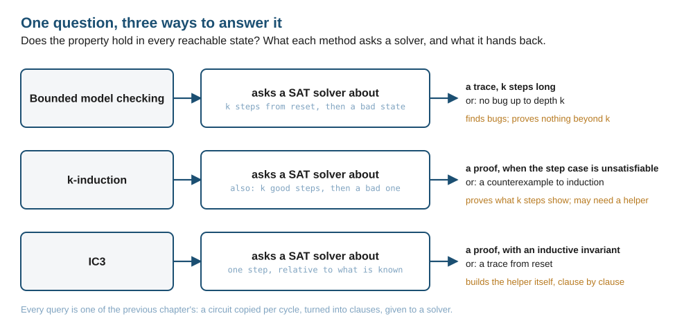

# Formal Property Verification {#sec-ch18}

> A counterexample is a fact about the design. A proof is a fact about the design, the assumptions and the question.

::: {.callout-note title="Learning objectives"}
After this chapter you will be able to:

1. Say what a safety property asks of a design's state graph, and place the reachable states, the property and an inductive invariant in one picture.
2. Say what a bounded search establishes and what it leaves open, and read a depth, a bound and `undetermined` in a report without over-reading any of them.
3. Write the base case and the step case of k-induction, read a counterexample to induction, and tell a property that is false from one that is true and not inductive.
4. Strengthen a property with a helper invariant, and list what the proof then rests on.
5. Follow IC3 on a small design through frames, its three queries, blocking and generalizing a state, propagation and the fixed point, and check the invariant it returns with three satisfiability queries.
6. State what an assumption does to every engine's question, detect an over-constraint, and say why the same over-constraint reads `proven` under one engine and `undetermined` under another.
7. Use covers as reachability questions, and a witness cover for each property as the check that a proof is not vacuous.
8. Read a liveness counterexample as a lasso, write the fairness assumption that removes an unfair one, and say what a bounded rewrite of the property promises that the eventual form does not.
9. Choose an engine for a property from the kind of answer you expect, and look up in three tables what the tool accepts, what each shell command does, and which engine answered what.
:::

## Four rows nobody opened

In @sec-ch09-example a formal tool was given the repaired FIFO and one property of its registers: when the FIFO is empty, the write pointer equals the read pointer. The property is true. The report had four blocks for it, and the text moved on:

```{.text include="examples/ch09-temporal-properties/fifo-proof/run.out" lines="13-29"}
```

Read the rows for `EmptyPtrs_A` one at a time. Bounded search: `undetermined`. Induction: `undetermined`. Induction again, with a second property assumed: `proven`. A third engine, alone: `proven`. Two of these rows are statements about the design. A `proven` says that no trace of the design, of any length, under the stated assumptions, violates the property. The other two are statements about an engine and a clock: neither engine finished within the limit that script set, and that is all `undetermined` says. The report prints the same word for a search that was about to find a bug and for a search that would never have ended.

That chapter could not show what happened inside, because the shell prints no bound, no induction depth and no invariant (@sec-ch09-formal). The chapter before this one built the machinery underneath, a solver and an unrolled circuit, and stopped at the sentence that a bound is not a proof (@sec-ch17-example). This chapter opens the four rows. It does so on a FIFO of two entries, whose model has five state bits, so that every state can be listed, every query counted and every engine written in a page of Python on top of the solver of @sec-ch17-cdcl. Then it goes back to the tool and to 64 entries, where nothing can be listed, and asks the reader to predict the rows before running them.

{#fig-ch18-map fig-alt="Three rows. Bounded model checking asks a solver about k steps from reset followed by a bad state, and returns a trace or nothing up to depth k. k-induction also asks about k good steps followed by a bad one, and returns a proof, a trace or a counterexample to induction. IC3 asks about one step relative to what is known, and returns a proof with an inductive invariant or a trace."}

@fig-ch18-map is the plan. Bounded model checking searches forward from reset. Induction asks whether the property can be left in a step. IC3 builds, one clause at a time, a set of states that contains everything reachable and nothing bad. The second half of the chapter is about the parts of a formal result that no engine supplies: the assumptions, the covers that show a proof was not empty, and the properties that say *eventually*.

The method was introduced under the name *model checking* in the early 1980s by Clarke and Emerson and, independently, by Queille and Sifakis [@clarke1981modelchecking; @queille1982cesar]. *Formal property verification* is the industry's name for model checking applied to RTL with properties written in an assertion language.

## States, reachability and invariants {#sec-ch18-reach}

A synchronous design with its registers, its reset and its input assumptions is a *transition system*. A *state* is one value for every register. The *initial states* are the states the design can be in during the first cycle. There is a *transition* from state $s$ to state $s'$ if some input that the assumptions allow takes the design from $s$ to $s'$ in one clock cycle. A state is *reachable* if a sequence of transitions leads to it from an initial state. Write $I(s)$ for "s is initial", $T(s, s')$ for "there is a transition from $s$ to $s'$" and $P(s)$ for "the property holds in $s$"; a state where $P$ is false is *bad*.

::: {.callout-note title="Definition"}
A **safety property** of a transition system, in the form this chapter uses, is a set of bad states together with the claim that no bad state is reachable. A **counterexample** is a sequence of states $s_0, s_1, \ldots, s_k$ with $I(s_0)$, $T(s_i, s_{i+1})$ for every $i < k$, and $s_k$ bad.
:::

An assertion that looks back or forward a fixed number of cycles fits this form after the tool adds registers that remember what the assertion needs; from here on the property is a predicate on one state. The general definition of safety, and its difference from liveness, is in @sec-ch09-ltl.

The design is the repaired FIFO of @sec-ch09-example with two entries. A wrapper holds reset for the first cycle and states the property as an immediate assertion, in the style of the wrappers of @sec-ch17-example:

```{.systemverilog include="examples/ch18-formal-property-verification/common/fifo_ptrs.sv" lines="11-40"}
```

The formal tool compiles the wrapper to an and-inverter graph with five latches: `started`, one bit for each pointer, and two bits of `count`. The memory is gone, because nothing in the property depends on the data. Five latches are 32 states, and a short script walks all of them using the model itself as the transition function:

```{.text include="examples/ch18-formal-property-verification/reach/run.out" lines="4-27"}
```

Sixteen of the 32 states have `started` low. They are the possible first cycles, all of them initial, because a register without a reset value may hold anything. After the reset cycle the design is in one state, empty with both pointers at zero, and from there it reaches five more. That is all: six states out of sixteen. Two states are bad, the two in which `count` is zero and the pointers differ. The remaining eight satisfy the property and are never entered. @fig-ch18-sets draws the sixteen.

![The two-entry FIFO's sixteen states after reset, computed by the `reach` example from the model. The blue outline is the set of states that satisfy `count[0] == wr_ptr ^ rd_ptr`, which a later section calls the helper.](../figures/ch18-sets.svg){#fig-ch18-sets fig-alt="A four by four grid: rows are the four pointer pairs, columns are count 0 to 3. Six cells are green and labeled with the step that first reaches them, 1 to 4. Two cells in the count 0 column are amber and labeled bad. Eight cells are white. A blue outline marks eight cells: the six green ones and two white ones in the count 3 column."}

The eight white states are where this chapter happens. An engine that looks only at what is reachable from reset never sees them. An engine that reasons about steps from arbitrary states sees all of them, and has to be told, or has to discover, that they do not matter.

::: {.callout-note title="Definition"}
An **invariant** of a transition system is a set of states that contains every reachable state. An **inductive invariant** is a set $\mathit{Inv}$ of states that contains every initial state and is closed under transitions: $I(s)$ implies $\mathit{Inv}(s)$, and $\mathit{Inv}(s)$ with $T(s, s')$ implies $\mathit{Inv}(s')$. An inductive invariant **proves** a safety property if it contains no bad state.
:::

Every inductive invariant is an invariant: the reachable states are built from the initial states by transitions, and neither step leaves the set. The converse fails, and the difference is the subject of the next three sections. The script asks the three questions of three candidate sets:

```{.text include="examples/ch18-formal-property-verification/reach/run.out" lines="28-36"}
```

The property itself, taken as a set of fourteen states, is an invariant, since no bad state is reachable. It is not inductive: one of the white states, with `count` at one and equal pointers, steps into a bad state by a read. That step is real logic. The design does exactly that when it is in that state. It is never in that state. The set of six reachable states is inductive, as the reachable set of any system is, and it proves the property. So does a set of eight, the blue outline of the figure. A proof of a safety property is the exhibition of an inductive invariant between the reachable states and the bad ones, and the three proof methods of this chapter are three ways to find one or to do without finding one.

::: {.callout-warning title="Pitfall"}
*True* and *inductive* are different words. A property that fails an induction check is not thereby false, and the state the tool shows for the failure need not be reachable. Before debugging the design from such a state, ask whether the design can get there.
:::

Listing states does not scale: every added register doubles the count, and the 16-entry FIFO's model in @sec-ch17-example already had ten latches after reduction and 146 state bits before. The engines below never list states. They ask a solver about formulas over $I$, $T$ and $P$, each of which is a circuit and so, by @sec-ch17-tseitin, a set of clauses.

## Bounded model checking as a method {#sec-ch18-bmc}

@sec-ch17-example built the query. Copy the logic once for each cycle, tie each copy's next-state outputs to the next copy's state, constrain the first copy to be initial and ask for a bad state in the last:

$$I(s_0) \land T(s_0, s_1) \land \cdots \land T(s_{k-1}, s_k) \land \lnot P(s_k).$$

A satisfying assignment is a counterexample of $k$ steps; the assignment's input values are the stimulus and its state values are the waveform. *Unsatisfiable* says that no trace of exactly that length ends in a bad state. Asking for $k = 0, 1, 2, \ldots$ in turn is *bounded model checking*, introduced by Biere, Cimatti, Clarke and Zhu [@biere1999symbolic]. This section is about what the method is worth as a method.

A counter makes the depth of a bug a parameter. Its forbidden value is `BUG` enabled steps from reset, and its one free input gives the search a choice in every cycle:

```{.systemverilog include="examples/ch18-formal-property-verification/bmc-depth/deep.sv" lines="5-20"}
```

```{.text include="examples/ch18-formal-property-verification/bmc-depth/run.out"}
```

Three things in this report are worth a sentence each.

The depths are 17, 65 and 129: one more than `BUG`, because this tool numbers the reset cycle 0, so the counter holds zero in cycle 1 and `BUG` after that many enabled cycles more. A depth is the index of the cycle in which the property fails. When the engine tries the bounds in order, the first satisfiable one is the shortest counterexample, and that is a real service to whoever debugs it: no test hits a bug in fewer cycles.

The fourth block uses the tool's engine `informal-bmc-10`, which according to the tool's engine documentation adds ten frames between solver calls [@informal-tool]. It reports depth 66 for a bug whose shortest trace has depth 65. Both are counterexamples. An engine that does not try every bound may return a trace that is longer than necessary, and the script checks only what can be promised: the depth is not below 65.

The last two blocks print the same row, `undetermined`, for two opposite situations. In one the property is true: with `en` assumed low the counter never moves, and a bounded search would run forever without finding or proving anything. In the other the property is false and the bug is 1,024 steps away; three seconds were not enough to unroll that far. Nothing in the row tells the two apart.

::: {.callout-warning title="Pitfall"}
`undetermined` is a statement about a run: this engine, this time limit, no verdict. It is not evidence that the property holds, and it is not evidence that it is hard. This book writes *no verdict within the limit* and gives the limit.
:::

Can a bounded search ever prove a property? In principle, yes. If no bad state is found within $k$ steps and every reachable state is reachable within $k$ steps, there is no bad reachable state.

::: {.callout-note title="Definition"}
A **completeness threshold** for a transition system and a safety property is a bound $k$ such that, if no counterexample of at most $k$ steps exists, none exists at all.
:::

The term is from Clarke, Kroening, Ouaknine and Strichman [@clarke2004completeness]. For the two-entry FIFO the script of the last section computed a threshold directly: the deepest reachable state is first reached at step 4, so a search through bound 4 has visited every reachable state. Nobody computes it this way for a real design, because finding the deepest reachable state is the reachability problem the search was meant to avoid. For the counter above with its 16-bit register, the threshold is of the order of 65,536, and the run above did not reach depth 1,025 in three seconds. A bounded search is a bug finder with a guarantee attached: what it finds is real and, tried in order, shortest. What it does not find, it says nothing about beyond the bound it reached, and this tool's report does not print that bound.

::: {.callout-tip title="In Practice"}
A bounded result is worth recording only with its bound. "No counterexample to depth 40, and the deepest behavior the block has, a full queue drained, takes 33 cycles" (the depth of the `Drained_C` cover in @sec-ch09-example) is an argument a reviewer can weigh. "BMC passed" is not. The covers of @sec-ch18-cover are how the second half of that sentence is measured and not guessed.
:::

## Induction {#sec-ch18-induction}

To prove something about every reachable state without visiting them, borrow the shape of a proof by induction over the natural numbers. Show that the property holds in the initial states. Show that if it holds in a state, it holds in every successor. Then it holds everywhere the design can go.

The second part is one satisfiability query about one copy of the logic: is there a state $s$ with $P(s)$, a transition $T(s, s')$ and $\lnot P(s')$? If not, $P$ is an inductive invariant and the proof is done. If so, the solver returns such a pair. For the two-entry FIFO it must return one, because the last section found that the property is not inductive. The idea of k-induction is to make the hypothesis longer: not one good state before the bad one, but $k$ of them in a row.

::: {.callout-note title="Definition"}
**k-induction** proves a safety property $P$ with two queries for a chosen $k \ge 1$. The **base case** asks for a counterexample of fewer than $k$ steps: an initial state, then at most $k - 1$ transitions, ending in a bad state. The **step case** asks for $k + 1$ states $s_0, \ldots, s_k$ joined by transitions, with $P$ true in $s_0, \ldots, s_{k-1}$ and false in $s_k$; its first state is *not* required to be initial. If both are unsatisfiable, $P$ holds in every reachable state.
:::

The argument: suppose a bad state were reachable, and take a shortest path to one. By the base case it has at least $k$ steps, so its last $k + 1$ states exist, and all but the last are good because the path is shortest. That is a model of the step case, which has none. Induction on the depth of a path with a satisfiability solver was published by Sheeran, Singh and Stålmarck [@sheeran2000checking], and an incremental formulation by Eén and Sörensson under the name temporal induction [@een2003temporal].

The chapter's engine is thirty lines on the unrolling class of the last chapter. It raises $k$ from zero, and at each value asks first the base query and then the step query:

```{.python include="examples/ch18-formal-property-verification/kind/kind.py" lines="33-62"}
```

The script's `k` is the definition's, with two additions. It starts at zero, where the step query is simply "is there a bad state at all". And its base query at `k` asks for a bad state exactly `k` steps from reset, the earlier depths having been asked in earlier rounds, which is one depth more than the definition needs. On the two-entry FIFO:

```{.text include="examples/ch18-formal-property-verification/kind/run.out" lines="1-18"}
```

Every base case is unsatisfiable: there is no counterexample, as the enumeration already showed. Every step case is satisfiable, at every $k$ up to 8 and, by the argument below, at every larger one. The decoded path says why. It starts in a state with `count` at three, which a two-entry FIFO never holds; a simultaneous read and write move both pointers and leave the count alone; the same again brings the path back to its first state; and then a read with the count somehow at zero and the pointers apart is the bad state. All four states are unreachable. The solver was asked for any states that fit the transition relation, and it found some.

::: {.callout-note title="Definition"}
A **counterexample to induction** is a model of the step case: a sequence of states joined by transitions, good in all but the last, with no requirement that the first be reachable. It shows that the property is not k-inductive for that $k$. It does not show that the property is false.
:::

A counterexample to induction and a counterexample are both printed as waveforms, and telling them apart is the first skill of formal debugging. A counterexample starts in reset. A counterexample to induction starts wherever the solver liked. The question to ask of its first state is the one from the pitfall above: can the design get there? If it can, there is a path from reset to that state, the base case will find the bug at a larger $k$, and the property is false. If it cannot, the property may well be true, and the unreachable state is what the proof needs to be told about.

Why did raising $k$ not help? Because states 0 and 2 of the path are the same state. The path walks around a cycle among unreachable good states, and a cycle can be walked any number of times: for every $k$ there is a path of $k$ good states that goes round often enough and then steps out to the bad one. Forbidding that is the second idea of the Sheeran, Singh and Stålmarck paper, which requires the states of the path to be pairwise different and notes that induction on depth is incomplete without the requirement [@sheeran2000checking].

::: {.callout-note title="Definition"}
The **unique-states constraint**, also called the **simple-path** or loop-free constraint, adds to the step case that $s_i \ne s_j$ for all $i < j \le k$. With it, k-induction is **complete** for finite systems: for every true safety property there is a $k$ at which the step case is unsatisfiable.
:::

Completeness has a short proof. A system with $n$ state bits has $2^n$ states, so a path of pairwise different states has at most $2^n$ of them. At $k = 2^n$ the step case asks for $2^n + 1$ different states and has no model, whatever the property. If the property is true the base case never has one either. Removing a repeated stretch from a path does not lose a counterexample, since the shorter path still ends in the same bad state, so the constraint is sound. In `kind.py` it is the function `differ`, a few clauses for each pair of copies, switched on by an argument:

```{.text include="examples/ch18-formal-property-verification/kind/run.out" lines="19-38"}
```

Proven at $k = 7$, with a model that has 32 states. @fig-ch18-cti puts the two paths at $k = 3$ side by side. The second has no repeated state, and there are only so many good unreachable states to visit before the path runs out of them.

{#fig-ch18-cti fig-alt="Two rows of four boxes joined by arrows. First row: wr=1 rd=1 count=3, then wr=0 rd=0 count=3, then wr=1 rd=1 count=3 again, then the bad state wr=0 rd=1 count=0. Second row: wr=1 rd=0 count=2, then wr=1 rd=1 count=1, then wr=0 rd=0 count=1, then the same bad state. Every state but the last is marked good and not reachable."}

The last block of the output is the method on a design with a bug, the FIFO of @sec-ch01-example in the model of @sec-ch17-example: the base case becomes satisfiable at 16, as bounded search found there. Induction contains bounded search as its base case, which is why an induction engine reports counterexamples as well as proofs.

Complete does not mean practical. The bound from the argument above is $2^n$, the same exponential as listing the states, and nothing promises that the $k$ which works is much smaller. On two entries it was 7. The tool's induction engine, which its documentation describes as k-induction with unique-state constraints added as needed [@informal-tool], proves this property at two entries and gave no verdict at four entries within its limit in the measurements of @sec-ch18-engines. That is one design and one limit, and no rule; it is also the common experience that a property whose proof depends on *which states are reachable* is not one for induction alone.

::: {.callout-warning title="Pitfall"}
The $k$ in this chapter's script, the depth a tool prints with a counterexample, and the bound an induction engine reports while it runs are three numbers with three conventions: whether the reset cycle counts, whether $k$ counts states or transitions, whether the base case at $k$ includes depth $k$. Compare them only after working out each convention on a design whose answer you know, as the counter above allows.
:::

## Strengthening by hand: one helper {#sec-ch18-helper}

There is a better use of a counterexample to induction than a larger $k$. The path started in a state with `count` at three, or in one where the count and the pointers disagree. Say so. The designer knows a fact about this FIFO that the property does not mention: the occupancy and the pointers move together, so the low bits of `count` always equal the distance between the pointers. For two entries that is one bit, `count[0] == wr_ptr ^ rd_ptr`, the blue outline of @fig-ch18-sets.

::: {.callout-note title="Definition"}
A **helper invariant**, or helper, is a property that is proved first and then assumed in the proof of another. **Inductive strengthening** is replacing a property $P$ that is true and not inductive by a stronger $P \land H$ that is inductive. The proof of $P$ then rests on the proof of $H$.
:::

Both halves can be run. The first block proves the helper by itself; the second assumes it, as a constraint on every state of the unrolling, and proves the property:

```{.text include="examples/ch18-formal-property-verification/helper/run.out"}
```

The helper is proved at $k = 1$: it is inductive in the plain sense, one good state implies the next. With the helper assumed, the property is proved at $k = 0$, which in this script means that the step query "is there a bad state among the states that satisfy the helper" has no model. No induction is left to do. Both bad states have `count` at zero and unequal pointers, so `count[0]` is 0 and the exclusive-or is 1: the helper excludes them outright. The same holds at four entries, where the helper is a two-bit equation.

The helper's set has eight states and the reachable set has six. A helper does not need to be exact. It needs three properties, the three questions of @sec-ch18-reach: true in reset, closed under a step, and free of bad states once joined with the property. The two unreached states it lets in, both with `count` at three, do no harm, because the set as a whole is closed under a step and holds no bad state.

What the proof rests on has changed, and a verification plan has to record it. Before, there was one claim: the property holds. Now there are two results, and the second is conditional: the helper holds, and the property holds *wherever the helper does*. The conclusion follows only when both are in the same regression and the first is still passing. A helper that is assumed and no longer proved is an unchecked assumption about the design's own registers, which is the most dangerous kind, because it can hide a bug in exactly the logic it describes.

::: {.callout-tip title="In Practice"}
Keep each helper as an assertion in the source, and derive the assumption from it in the proof script, as the worked example of @sec-ch18-example does by disabling the one and adding the other. Then the helper cannot be assumed without existing as something the regression proves. Name the pair so that the report shows which is which; this book uses the suffixes `_A` and `_M`.
:::

Where does a helper come from? From the counterexample to induction, read by someone who knows the design. The state the solver starts in is unreachable for a reason, and the reason, written as an expression over the registers, is a candidate. Typical helpers are the ones this FIFO needs: two registers that encode the same quantity agree; a counter stays within its range; a state register is one-hot; a valid bit is low whenever its queue is empty. They are facts so obvious to the designer that nobody thought to write them down, and that is why the solver, which knows nothing obvious, has to be told. The next section is about an engine that works them out.

## Strengthening by machine: IC3 {#sec-ch18-ic3}

Bounded search and induction both unroll: their queries grow with $k$, and their answer to an unreachable state is a longer path. In 2011 Bradley published an algorithm that asks only about single steps and constructs the strengthening itself, a clause at a time [@bradley2011sat]. He called it IC3. Eén, Mishchenko and Brayton described an efficient implementation of it under the name *property directed reachability*, PDR, and their paper is the source of some of the vocabulary used below [@een2011pdr]. The two names denote one algorithm. It is the engine behind the fourth row of the opening report.

### Cubes, lemmas and frames

IC3 talks about sets of states in two dual forms.

::: {.callout-note title="Definition"}
A **cube** is a conjunction of literals over the state bits, such as `wr_ptr=1 rd_ptr=0 count[0]=0`; it stands for the set of all states that agree with it, so a cube with fewer literals is a larger set. A **lemma** is the negation of a cube, a clause, read as "the design is never in these states". A cube is **blocked** when a lemma excluding it has been learned.
:::

The engine keeps a sequence of sets $F_0, F_1, \ldots, F_k$, each a conjunction of lemmas.

::: {.callout-note title="Definition"}
A **frame** $F_i$ is a set of states, held as a set of lemmas, that contains every state reachable in at most $i$ steps and possibly more. IC3 maintains four facts about its frames: $F_0$ is the set of initial states; each frame is contained in the next, $F_i \subseteq F_{i+1}$; every transition from a state of $F_i$ ends in $F_{i+1}$; and no frame below the last contains a bad state. The last frame, $F_k$, is the **frontier**.
:::

Bradley's paper states invariants of this kind for its sequence [@bradley2011sat]; the wording here describes this chapter's script, `ic3.py`, which stores each lemma once, at the highest level $i$ for which it is known to hold in $F_1$ to $F_i$. That storage makes the second fact true by construction, and Eén, Mishchenko and Brayton describe the same arrangement [@een2011pdr].

The four facts say that the frames are over-approximations that get looser with distance: $F_1$ may claim a lot, since little is reachable in one step, and $F_5$ must allow more. They also say when to stop. If two neighboring frames are equal, $F_i = F_{i+1}$, then by the third fact a step from $F_i$ stays in $F_i$, by the first two it contains the initial states, and by the fourth it contains no bad state. It is an inductive invariant that proves the property.

### Three questions about one step

All of the engine's reasoning goes through three satisfiability queries, each over one copy of the transition logic. In the script they are three short methods:

```{.python include="examples/ch18-formal-property-verification/ic3/ic3.py" lines="49-67"}
```

The first asks whether the frontier still contains a bad state. The third asks whether a lemma that holds in $F_i$ also holds one step later and can be moved up. The second is the heart of the method and has a name.

::: {.callout-note title="Definition"}
A lemma $\lnot c$ is **inductive relative to** a frame $F$ if no initial state is in the cube $c$ and no transition leads from a state of $F$ outside $c$ to a state inside $c$: the query $F(s) \land \lnot c(s) \land T(s, s') \land c(s')$ is unsatisfiable. If $\lnot c$ is inductive relative to $F_{i-1}$, it may be added to every frame up to $F_i$ without breaking the four facts.
:::

Plain induction asks whether a property is closed under a step from *anywhere*. Relative induction asks the same from within a frame, which already excludes much of what is unreachable. That is how the engine uses what it has learned, and the term is defined in Bradley's paper [@bradley2011sat].

### Blocking a bad state

When the frontier $F_k$ contains a bad state $s$, the engine tries to block it: to show that $s$ is not reachable in $k$ steps. It asks the second question about $s$ and $F_{k-1}$. If the answer is unsatisfiable, a lemma excluding $s$ can be added. If it is satisfiable, the model is a state $p$ in $F_{k-1}$ with a step into $s$, and $s$ cannot be excluded until $p$ is.

::: {.callout-note title="Definition"}
A **proof obligation** is a pair of a cube and a frame index $i$: the cube must be shown unreachable within $i$ steps before the engine can continue. Blocking a bad state creates obligations at lower and lower frames. If an obligation reaches frame 0, its cube contains an initial state, and the chain of obligations is a counterexample.
:::

The term, and its definition as a pair of a cube and a frame, are from Eén, Mishchenko and Brayton [@een2011pdr]. In the script the obligations are a list of triples, each remembering the obligation it was created for, so that the chain can be read back as a trace:

```{.python include="examples/ch18-formal-property-verification/ic3/ic3.py" lines="84-109"}
```

One line in it does more work than the rest: `generalize`. A lemma that excludes exactly one state would make IC3 an enumeration of states, one query each.

::: {.callout-note title="Definition"}
**Generalization** replaces a cube that is to be blocked by a larger cube, with fewer literals, whose lemma is still inductive relative to the same frame and still excludes no initial state. One lemma then blocks many states, most of which the engine never visited.
:::

The script generalizes in the simplest way: drop one literal, ask the second question again, keep the smaller cube if the answer is still unsatisfiable. The tool's IC3 engine, according to its documentation, starts from the solver's unsatisfiable core and minimizes the cube further [@informal-tool].

### One run, read line by line

The first two frontiers of the run on the two-entry FIFO:

```{.text include="examples/ch18-formal-property-verification/ic3/run.out" lines="1-23"}
```

The output leaves `started=1` out of every cube. At frontier 1 the engine finds a bad state in $F_1$, which so far has no lemmas and is every state. It has no predecessor in $F_0$, the reset cycle, so it is blocked, and generalization shrinks the five-literal state to a single literal: *never `wr_ptr=1`*. That is false of the design, and it is not claimed of the design. It is claimed of $F_1$, the states within one step of reset, where the only post-reset state is the empty one.

At frontier 2 the same bad state is found in $F_2$, and now it has a predecessor in $F_1$: `count=3` with both pointers at zero. It is a white state of the kind that defeated induction. IC3 does not walk around it. It takes it as an obligation one frame down, finds that nothing in $F_0$ steps into it, and learns *never `count[1]=1`* at level 1; then the original state is blocked at level 2. After each frontier comes propagation: every lemma is asked the third question and moves up a level if it passes. The run needs five frontiers:

```{.text include="examples/ch18-formal-property-verification/ic3/run.out" lines="64-77"}
```

After the fifth propagation, level 4 is empty. Every lemma of $F_4$ has moved to level 5, so $F_4 = F_5$, and the six lemmas at level 5 are the invariant. @fig-ch18-frames shows the levels filling and emptying.

{#fig-ch18-frames fig-alt="A table with five rows, one for each cleared frontier, and six columns, levels 1 to 6. The first row holds 2 and 0. The last row holds 2, 4, 1, 0, 6 and 0: level 4 is empty and highlighted, and level 5 holds six lemmas."}

Decoded, the invariant is two facts. Lemmas 2 and 3 say that when the pointers differ `count[0]` is one, and lemmas 5 and 6 that when they are equal it is zero: together, `count[0] == wr_ptr ^ rd_ptr`, the helper of the last section. Lemma 1 says the count is never three. Lemma 4 follows from lemma 2 and was kept only because this small script never looks for subsumed lemmas. The engine was told nothing about the design. It derived the helper from the bad states backward, which is the sense of *property directed*, and it found a second fact the hand proof did not need. The set the six lemmas allow is, on this model, exactly the reachable set, 22 states with the reset cycle's sixteen. That is a coincidence of a small model; in general IC3 stops at the first inductive set it finds, which may be much larger than the reachable one.

The last lines of the output are the engine on other models:

```{.text include="examples/ch18-formal-property-verification/ic3/run.out" lines="78-83"}
```

IC3 finds counterexamples too, and pays for them: 1,462 single-step queries for the FIFO bug that bounded search reached with seventeen unrollings in @sec-ch17-example. The queries are small and the unrollings are large, so a count of queries is not a comparison of cost. It does say which engine goes at a bug directly.

::: {.callout-tip title="In Practice"}
IC3 is the engine to reach for when a property's truth depends on which states are reachable and nobody has written the helper. It is also an engine whose running time is hard to predict, because it depends on how well each lemma generalizes. A helper that a designer can state in one line is still worth stating: @sec-ch18-engines measures the difference.
:::

Between induction and IC3 in history stands a third idea, which this book describes and does not run. McMillan showed in 2003 that the solver's refutation of a bounded unrolling can be turned into a formula over the state after one step, an *interpolant*, that contains every state reachable in one step and still cannot reach a bad state within the bound; iterating the construction reaches a fixed point, which is an inductive invariant [@mcmillan2003interpolation]. The tool this book runs has no interpolation engine at the pinned commit, according to its engine documentation [@informal-tool].

## What the tool shows of all this {#sec-ch18-trust}

The chapter's engines are for reading. They are checked, so that what was read is right: a separate example runs them on 300 random transition systems and on every single-edge mutant of the FIFO model, and compares each verdict, each counterexample and each invariant with explicit-state search.

```{.text include="examples/ch18-formal-property-verification/ic3-fuzz/run.out"}
```

Plain induction leaves some true properties undecided at the bound the test allows; induction with unique states and IC3 decide every case, as both must on a finite system.

The tool's engines are for use, and show much less. Its report has a status and, for a trace, a depth. With an environment variable set, its IC3 engine prints one line of statistics, of which the example keeps three counts, and its induction engine, run as a separate process on the model file, prints the bounds it passes:

```{.text include="examples/ch18-formal-property-verification/engine-view/run.out" lines="15-25"}
```

Frames, lemmas, queries: the nouns of the last section, as counts. No lemma is printed, and no counterexample to induction. The counts differ from the chapter's script on the same FIFO, because the tool builds its own model from the SystemVerilog and its engine generalizes differently; only the kind of number is the same. And the induction engine's *bound 6* is that engine's convention for $k$, not this chapter's.

The line `certificate: Ok` matters more than the counts. A verdict from a large program deserves the question of @sec-ch17-cdcl: who checks it? Both verdicts of a model checker can be checked by something much simpler than the checker.

::: {.callout-note title="Definition"}
A **certificate** for a verdict is evidence that a simple, independent program can check. For a counterexample it is the trace: replay the inputs on the model and watch the bad state arrive. For a proof it is an inductive invariant: three satisfiability queries, each over at most one step, confirm that it holds in every initial state, is closed under a transition, and contains no bad state.
:::

The function `certify` at the end of `ic3.py` is those three checks in ten lines, and the IC3 output above ends with their result. The tool's documentation says its IC3 engine's invariant is checked before `proven` is reported [@informal-tool], and the line above is that check's result. The 2024 edition of the hardware model checking competition made certificates mandatory in its bit-level tracks [@hwmcc2024]; certifying model checking results in a common format is the subject of work by Yu, Biere and Heljanko [@yu2021progress]. The tool at this commit writes no certificate file. A k-induction proof has a certificate too, but not as directly: the property is not itself an inductive invariant, which was the whole difficulty.

## Assumptions are part of the question {#sec-ch18-assume}

Every query in this chapter contained $T$, and $T$ was defined at the start as the transitions *that the assumptions allow*. An assumption is not a filter applied to results. It is a conjunct of every formula every engine builds, so it changes what *reachable*, *counterexample* and *proven* mean. @sec-ch09-where introduced assumptions as the environment's side of a contract. This section is about what goes wrong, and what a report shows when it does.

The design is a handshake with a slow timer inside. It has a true assertion, that a grant follows a busy cycle, and a deliberately false one, that there is never a grant at all:

```{.tcl include="examples/ch18-formal-property-verification/over-constraint/assume.tcl" lines="11-15"}
```

With no assumptions, the tool proves the first and refutes the second, with a trace 202 cycles deep: the reset cycle, a request, two hundred cycles of timer and the grant. Then three sets of assumptions are added in turn:

```{.text include="examples/ch18-formal-property-verification/over-constraint/run.out" lines="1-37"}
```

In each of the three, `a_false` is *proven*. The proof is correct. Under `assume {!req}` no request ever arrives, so no grant is ever given, so "never a grant" holds in every trace that the assumption allows.

::: {.callout-note title="Definition"}
A set of assumptions is an **over-constraint** if it excludes behavior that the real environment can produce. A property proved under an over-constraint is proved only for the behavior that remains. Assumptions are **contradictory** if no trace satisfies all of them; then every assertion is proved and every cover is unreachable.
:::

The three cases are three degrees of the same failure. The first is a plain over-constraint: traces exist, and none of them does anything. The second is a contradiction in one cycle, a data value below eight and above nine, and it leaves no trace at all: even the cover of the constant `1'b1` is unreachable. The third is the kind that reaches real projects. Each assumption is reasonable alone, *always request* and *never request while busy*; together they have no continuation once the first request has made the design busy. A trace counts only if every assumption holds in every one of its cycles, so the traces under this pair all end before `busy` is ever seen high. The constant cover is still reached, at depth 1, which is why a single always-true cover does not detect a contradiction that takes time to bite.

Look for what is the same in the three reports. The assertion rows all read *proven*. The row that changed is a cover. Nothing else in a report shows an over-constraint, and this is the general statement:

::: {.callout-warning title="Pitfall"}
An over-constrained proof and a sound proof print the same word. The evidence that assumptions leave the interesting behavior possible is never in the assertion rows. It is in the covers, and only if somebody wrote covers for the behavior that matters.
:::

The last block of the output runs the third set of assumptions under bounded search alone:

```{.text include="examples/ch18-formal-property-verification/over-constraint/run.out" lines="38-48"}
```

The same over-constraint that read *proven* now reads *undetermined*, and the covers that read *unreachable* now read *undetermined* too. Nothing about the assumptions changed. A bounded engine cannot report a proof, whether sound or vacuous, and it cannot report that a cover is unreachable, which is also a proof. So an over-constraint is invisible to an engine that only searches, and a team that runs bounded checks on an over-constrained environment sees a column of results that are no better and no worse than usual. The symptom appears on the day someone runs a proving engine, and it appears as good news.

How do over-constraints get written? Rarely as `!req`. They come from an assumption written to remove one counterexample that also removes legitimate traffic; from a protocol rule assumed more strictly than the specification states it; from two blocks' assumptions that are each fine and jointly impossible; from a reset or clock-enable assumption that holds the design still. The defenses are procedural, and @sec-ch18-example applies them: assumptions on inputs only, with the exception of proved helpers; each assumption checked as an assertion on the neighboring block or in simulation, the assume-guarantee discipline of @sec-ch09-where; and covers, proved reachable under the full set of assumptions, for every behavior the plan cares about.

::: {.callout-tip title="In Practice"}
Review assumptions harder than assertions. A wrong assertion fails and gets looked at. A wrong assumption makes failures go away and gets thanked. In a review, ask of each assumption who guarantees it, where that guarantee is checked, and which cover shows that the interesting traffic survives it.
:::

## Covers: reachability, and the check on every proof {#sec-ch18-cover}

A cover asks the dual question of an assertion. An assertion claims that no reachable state is bad. A cover asks whether some reachable state is *good*, in the sense of matching the cover's expression, and its two possible answers are of two different kinds.

::: {.callout-note title="Definition"}
A cover is **covered** when the tool exhibits a trace from reset, within the assumptions, to a state that matches it. A cover is **unreachable** when the tool proves that no such trace exists. *Covered* is a trace; *unreachable* is a proof, of exactly the same kind as *proven* for the assertion that the cover's expression never holds.
:::

That symmetry sorts the four verdicts of a report into two pairs. A counterexample and a covered cover are traces: a search can find them, and one trace settles the matter. A proof and an unreachable cover are statements about all traces: only a proving engine can give them. The example asks whether the FIFO can hold sixteen entries, of two designs and three engines. The FIFO of @sec-ch01-example, whose bug raises `full` at fifteen, cannot; the repaired one can:

```{.text include="examples/ch18-formal-property-verification/cover-engines/run.out" lines="81-88"}
```

On the repaired design every engine returns the trace, at the same depth. On the first design the two proving engines say *unreachable*, and bounded search says nothing within its limit, as it would for any limit.

An unreachable cover is one of the most useful things a formal tool prints, because it is so often a surprise. Here it is the bug itself: a 16-entry FIFO that can never hold sixteen entries. In other designs it is dead code, a state the encoding allows and the logic never enters, a configuration that an assumption has ruled out, or an error path that the environment cannot provoke. Each of these is either a finding or an entry for the coverage exclusions of @sec-ch08-closure, with a proof attached where simulation could only offer absence.

The second use of covers is the one the last section led to. A proof needs a companion that shows it had something to say.

::: {.callout-note title="Definition"}
A **witness cover** for an assertion is a cover of the situation the assertion is about: for an implication, its antecedent, together with enough of the consequent to show the interesting case occurring. An assertion that is proved while its witness cover is unreachable holds **vacuously**.
:::

Vacuity was defined in @sec-ch09-vacuity for a single trace in simulation, where an implication whose antecedent never matched passes without having checked anything; the notion comes from the model-checking literature [@beer2001vacuity]. In formal verification it is sharper. An unreachable witness is a proof that the antecedent can never match in *any* trace, so the assertion will never check anything, in this environment, on this design. The cause is either the design, as with the FIFO that never fills, or the assumptions, as in the last section. Either way the *proven* row above it is worth nothing until someone has explained the unreachable row.

A witness should be chosen with a little care. The cover of the bare antecedent is the minimum. For `EmptyPtrs_A`, whose antecedent is `empty`, the bare cover is reached in the first cycle after reset and shows nothing about a FIFO that has been used; the worked example covers *empty again, with the write pointer moved* instead. A depth printed beside a covered cover is also information: it is the length of the shortest trace to the situation, and so a lower limit on the bound a bounded check of the matching assertion needs before it has examined that situation even once.

::: {.callout-warning title="Pitfall"}
A covered witness shows that the antecedent can occur. It does not show that the assertion is strong enough, or that the interesting consequent occurs in more than one way. Formal coverage of the property set, which asks what part of the design the proofs actually depend on, is a subject of a later chapter on formal techniques.
:::

## Liveness and fairness {#sec-ch18-liveness}

Everything so far concerned safety: something bad never happens, and a violation is a finite trace that ends in the bad state. A liveness property says that something good eventually happens, and no finite trace violates it, because the good thing may still come one cycle after the trace ends. The distinction and its formal definition are in @sec-ch09-ltl; the classic reference is Alpern and Schneider [@alpernschneider1985liveness]. A simulation, being finite, cannot refute *eventually*. A formal tool can, and this section shows how.

The design takes a request, works for two cycles and grants. An input `stall` holds it in its last working state:

```{.systemverilog include="examples/ch18-formal-property-verification/lasso/live_small.sv" lines="6-20"}
```

The property is `req && n == 2'd0 |-> s_eventually gnt`: every request taken while idle is eventually granted. The tool refutes it:

```{.text include="examples/ch18-formal-property-verification/lasso/run.out" lines="1-11"}
```

A counterexample to *eventually* has to be an infinite trace on which the grant never comes. A finite-state design cannot produce an infinite trace without repeating a state, and once a state repeats, the inputs that led from its first occurrence to its second can be applied again, for ever.

::: {.callout-note title="Definition"}
A **lasso** is a finite trace whose last state equals one of its earlier states. The part before the repeated state is the **stem**; the part from its first occurrence to its second is the **loop**. A lasso stands for the infinite trace that follows the stem once and the loop for ever. A liveness property over a finite-state system is false exactly when some lasso violates it: the awaited event does not occur anywhere in the loop.
:::

The tool's comment under the report names the lasso: frame 4 has the state of frame 3 again. @fig-ch18-lasso draws it. The request arrives in cycle 1, the design works through cycles 2 and 3, and in cycle 3 `stall` is high, so in cycle 4 the register `n` is 2 again. The loop is one cycle long and `stall` sustains it.

{#fig-ch18-lasso fig-alt="A table of five cycles with rows rst, req, stall, n and gnt. rst is 1 in cycle 0 only, req is 1 in cycle 1 only, stall is 1 in cycle 3 only, n is 0, 0, 1, 2, 2 and gnt is 0 throughout. A bracket marks cycles 0 to 2 as the stem. An arrow from cycle 4 back to cycle 3 marks the loop."}

::: {.callout-warning title="Pitfall"}
Read a liveness trace by its loop, not by its last row. The last row is the state in which the loop closes; the inputs that drive the loop are in the rows before it. Here `stall` is 1 in the row of cycle 3 and 0 in the last row, and it is the 1 that matters. The depth can mislead as well: with a second property in the same session the tool printed this counterexample at depth 7 and not 4, as the example's second block shows, because the loop has to close in every register of the model, including the ones the other property added.
:::

How does an engine built for safety find a loop? By a construction due to Biere, Artho and Schuppan that turns the liveness question into a safety question on a larger design [@biere2002liveness]. Add a copy of every register. Add an input that, at a moment the solver chooses, saves the current state into the copy. Add a flag that records whether the awaited event has occurred since the save. The bad state of the new design is: the current state equals the saved one, and the flag says the event has not occurred. A trace to that bad state is a lasso, and the paper notes that the translation handles fairness too. The price is a model with twice the state bits. The tool's shell documentation says it reduces `s_eventually` this way, with a shadow copy of the state [@informal-tool]. After the reduction the property is a safety property, and bounded search, induction and IC3 apply to it as to any other.

### Fair and unfair counterexamples

The lasso above is correct and useless. Of course the grant never comes if the environment stalls for ever. No real environment does; the specification of `stall` surely says so somewhere. The counterexample is *unfair*, and the remedy is to tell the tool what the environment promises.

::: {.callout-note title="Definition"}
A **fairness assumption** is an assumption that something happens infinitely often: in SystemVerilog, an `assume` whose property says that at every point some condition will eventually hold, such as `s_eventually !stall` as a concurrent assumption. It removes every lasso whose loop never satisfies the condition. A counterexample that survives the fairness assumptions is a **fair** counterexample.
:::

There is a second remedy, which is to bound the environment: assume that a stall lasts at most one cycle. And there is a second form of the property, which is to bound the promise: granted within four cycles. The example runs both properties under no assumption, the fairness assumption and the bound:

```{.tcl include="examples/ch18-formal-property-verification/fairness/fair.tcl" lines="9-10"}
```

```{.text include="examples/ch18-formal-property-verification/fairness/run.out"}
```

Six results, and the pattern among them is the lesson. With no assumption both forms fail. Fairness proves the eventual form and does not prove the bounded one: an environment that stalls for two cycles and then stops is fair, and the grant arrives in the fifth cycle after the request, one too late. The bound on the environment proves both.

So the two forms promise different things and need different things. *Eventually* with fairness says the design never deadlocks or starves, provided the environment keeps moving; it says nothing about how long anything takes, and its proof survives any change to the design's latency. A bounded property says how long, is a safety property with a finite counterexample that any engine can find, and needs an environment bounded in time to be true at all. Performance requirements are of the second form. "The arbiter never starves a requester" is of the first, and rewriting it with a generous bound, as teams without a liveness engine do, changes its meaning: the bound becomes a number that someone has to maintain, and a failure of the rewritten property may be a latency change and not a deadlock.

::: {.callout-tip title="In Practice"}
Write the liveness property first, because it is the requirement. Prove it under fairness assumptions that name what the environment owes: every `ready` eventually rises, every stall eventually ends. Then, if the specification gives a latency, write the bounded property as a second, separate assertion with its own assumptions. And give each fairness assumption the review of @sec-ch18-assume: `s_eventually !stall` is an assumption on an input, and someone has to guarantee it.
:::

## Choosing an engine {#sec-ch18-engines}

The engines differ in the kind of answer they can give, and that, more than speed, decides which to run. If the expected answer is a trace, a counterexample or a covered cover, bounded search finds it most directly, and finds the shortest. If the expected answer is a proof and the property is a fact that one step of the design shows, induction proves it at once and its counterexample to induction is the most readable diagnosis when it does not. If the proof depends on which states are reachable, IC3 is the engine that works that out. The example `engine-guide` puts eight situations in front of three of the tool's engines and one external engine, each run alone with four seconds:



The rule in the last column is applied by the script, which fails if the engine it names gave no answer. The table is small, and each row is one design and one limit; what it shows is a pattern, not a ranking. Bounded search gave a verdict on every row whose answer is a trace and on no other. Induction and IC3 found every trace as well, at the same depths, since both contain a search from reset. The one-step fact was proved by all three proving engines, and so was the unreachable cover. The pointer property and the rule of the larger design of @sec-ch11 were proved by the two IC3 engines only. On the liveness row both in-house proving engines returned a proof within the limit, and the external engine returned none.

The fourth engine is rIC3, an IC3 implementation by Su and others [@su2025ric3], which the tool can call as an external program. It is named here to identify what the examples ran, and nothing in this book describes its internals. A script that selects it declares so, and the example is skipped where the program is not installed.

How do the verdicts move with size? The example `scaling` proves the pointer property and its helper at four FIFO depths:

```{.text include="examples/ch18-formal-property-verification/scaling/run.out" lines="118-129"}
```

{#fig-ch18-scale fig-alt="A grid of verdicts in three groups of three rows, the engines informal-kind, informal-ic3 and ric3-ic3, against FIFO sizes 2, 4, 8 and 64. For EmptyPtrs_A induction is proven only at 2, the in-house IC3 up to 8, the external engine at all four. For CountPtrs_A everything is proven except the in-house IC3 at 64. With the helper assumed all twelve cells are proven."}

Three observations, none of them a law. The helper, a one-step fact, is proved by induction at every size, and at 64 entries the in-house IC3 engine gave no verdict on it within five seconds: an engine that can do more is not thereby better at the easy case. The pointer property alone is proved by fewer engines as the FIFO grows. And with the helper assumed, the last three rows, size stops mattering to every engine. @fig-ch18-scale shows the grid. The designer's one line removed the dependence on depth that the engines, each in its way, were paying for.

This book's rule about timing is that seconds appear only in a table that carries its date and is regenerated by a script. This is that table:



Read it for orders of magnitude. Bounded search slows quickly with depth, because each bound is a larger formula. The in-house IC3 engine's time on the pointer property grows steeply with the size of the FIFO until the limit ends the run. With the helper assumed, every run is over well within a second.

::: {.callout-tip title="In Practice"}
A workable order for a new property: covers first, by bounded search, to learn the depths at which things happen. Then bounded search on the assertion, for the cheap bugs. Then a proving engine; if it returns no verdict, look at a counterexample to induction before raising the time limit, and write the helper it suggests. Running several engines at once and taking the first answer is what this tool does when no engine is selected, and is the right default; selecting one engine, as every example here does, is for learning what each can do and for keeping a regression's output the same from run to run.
:::

Other tools draw the same lines under other names. SymbiYosys, the open-source front end, has the modes `bmc`, `prove`, `live` and `cover`; in `prove` mode its `depth` option is the induction depth, and its default depth is 20 [@sby-docs]. The commercial property checkers are listed in @tbl-ch09-formal-tools, with what their vendors' pages state; their engines are not public and this book does not characterize them.

## Worked example: the pointer property at 64 entries {#sec-ch18-example}

Now the opening report can be predicted and not merely read. The design is the repaired FIFO at 64 entries. The property is the same, the pointers are equal when the FIFO is empty; the model is too large to enumerate, and the deepest behavior, a full FIFO drained, is over a hundred cycles from reset. The script is the whole method of the chapter as a procedure in seven steps. Its setup declares the property, the helper and three covers:

```{.tcl include="examples/ch18-formal-property-verification/fifo-64/fifo64.tcl" lines="6-17"}
```

Before reading on, predict the verdict of each step: bounded search on the covers; bounded search, induction and IC3 on the property alone; induction on the helper; induction and IC3 on the property with the helper assumed; the covers again.

Steps 4 to 6 in the script:

```{.tcl include="examples/ch18-formal-property-verification/fifo-64/fifo64.tcl" lines="52-77"}
```

Each `expect` line is the prediction, checked: the run fails if a verdict differs. The summary the script prints at its end:

```{.text include="examples/ch18-formal-property-verification/fifo-64/run.out" lines="76-90"}
```

**Step 1, covers.** All three are traces, so bounded search finds them. `Full_C` at depth 65: the reset cycle and 64 writes. `EmptyAgain_C` at depth 3: a write and a read. `Drain_C` at depth 129: 64 writes and 64 reads. These numbers are the first real knowledge about the design's time scale: any bounded check of the property that stops short of 129 has not seen a full FIFO drain.

**Step 2, bounded search on the property.** The property is true, so there is no trace to find, and the search returns no verdict. The prediction needs no knowledge of the engine.

**Step 3, induction.** The property is not inductive, by @sec-ch18-reach, and the unreachable states that defeat it are far more numerous than at two entries. No verdict in five seconds.

**Step 4, IC3.** This is the step where prediction is honest guesswork. IC3 can derive the helper, which at 64 entries is a six-bit equation between a count and a difference of pointers, and nothing says in advance how long that takes. The in-house engine gave no verdict in five seconds; the external engine proved it. A different limit or a different release could move either result, which is the nature of the engine and the reason the next two steps exist.

**Step 5, the helper alone.** One step of the design shows it: a write moves the write pointer and the count together, a read moves the read pointer and the count together. Induction proves it at once, at any size.

**Step 6, the property with the helper assumed.** With `count` tied to the pointers, an empty FIFO has equal pointers by arithmetic. Both in-house engines prove it within their limits. The assertion `CountPtrs_A` is disabled and the assumption `CountPtrs_M` is added with the same expression, so the two cannot drift apart.

**Step 7, the covers again.** An assumption was added in step 6, so the question of @sec-ch18-assume is open again: did it remove behavior? The three covers are reached at the same three depths. For a proved helper the answer was certain in advance, since a true invariant removes no reachable state; the step is in the procedure because the habit should not depend on that argument having been made correctly.

What the proof rests on, as it would be written in a verification plan: `EmptyPtrs_A` is proven at 64 entries by induction, under the assumption `CountPtrs_M`; `CountPtrs_M` is the assertion `CountPtrs_A`, proven by induction with no assumption beyond reset; the witness `EmptyAgain_C` and the covers `Full_C` and `Drain_C` are reached under the same assumptions. Each clause of that sentence is a row of the report.

::: {.callout-note title="Worked Example"}
The procedure, for another property. (1) Write witness covers and run them under bounded search; note the depths. (2) Run bounded search on the assertion; a counterexample ends the procedure with a bug. (3) Run a proving engine with a limit. (4) On no verdict, obtain a counterexample to induction and ask whether its first state is reachable. (5) If it is not, write the reason as a helper assertion over the registers, and prove the helper alone. (6) Assume the helper and prove the property. (7) Run every cover again under the final set of assumptions. (8) Record the property, each helper with its own proof, the assumptions and the covers together; none of them means anything alone.
:::

## Reference {#sec-ch18-reference}

Three tables, each generated by an example from the pinned tool, so that each can be regenerated when the tool changes. They record what this tool did, not what the language standard requires or what another tool does.

The first lists property forms. A probe for each form is run twice, as a property that holds on a small design and as one that does not, and a form counts as accepted only if both verdicts are right:



Of the 65 forms, 50 are accepted. Six are refused when the command is given and five when `prove` runs, each with a message. The four to worry about are the ones marked as dropped: the tool reads the file, omits the property from its report and prints nothing. An assertion that is not in the report cannot fail.

::: {.callout-warning title="Pitfall"}
After loading a design, compare the number of properties the tool lists with the number in the source. A property the front end did not understand may be missing without a message, and a missing assertion looks exactly like a passing regression. The example's script fails if the count of dropped forms changes, in either direction.
:::

The second table is the shell: its commands, run top to bottom in one session, with what the tool did for each line.



Four lines end in an error and two are accepted with a message that part of them was ignored; the rest run. Two details from the table recur in real scripts. A property written in the RTL is known by its hierarchical name, and the short name is an error. And `informal shell` exits with status 0 whatever was proved, which is why every script in this book checks its verdicts with `expect` and ends with `finish`, two procedures the book's scripts share.

The third reference is the engine table of @sec-ch18-engines, @tbl-ch18-engines.

::: {.callout-important title="Future Directions"}
Three developments are visible from here, and this chapter's examples touch each. Certificates are moving from a research topic to a requirement, as the competition's rule shows, and a proof that a small independent checker has confirmed is a different kind of evidence from a status word. External engines are becoming interchangeable parts behind a common model format, as the one this chapter called shows; a verification environment may soon choose engines the way it chooses solvers. And the work this chapter did by hand, reading a counterexample to induction and proposing a helper, is the kind of step that @sec-ch34 discusses handing to a program that proposes candidates, with the property checker as the judge of each. None of these changes what a proof rests on. Assumptions, covers and the question asked remain the engineer's.
:::

## Summary

- A safety property claims that no bad state is reachable. A proof exhibits, or implies, an inductive invariant: a set that holds the initial states, is closed under a step and contains no bad state. On the two-entry FIFO, 6 of 16 post-reset states are reachable, 2 are bad, and the property's own 14 states are not closed under a step.
- Bounded model checking finds counterexamples and, tried bound by bound, the shortest one. It proves nothing beyond the bound it reached unless that bound is a completeness threshold, which is as hard to know as the answer.
- `undetermined` is a statement about an engine and a limit. The same row is printed for a true property and for a bug beyond reach.
- k-induction adds a step case that starts anywhere. Its model is a counterexample to induction, which shows that the property is not k-inductive and not that it is false. With the unique-states constraint the method is complete on finite systems, at a $k$ that may be exponential.
- A helper invariant excludes the unreachable states a step case starts from. The proof then rests on the helper's own proof, and both belong in the regression.
- IC3 builds the strengthening itself: frames of lemmas, three single-step queries, blocking with generalization, propagation, and a fixed point when two frames are equal. On the two-entry FIFO it derived the helper in six lemmas.
- An inductive invariant is a certificate that three queries check; a counterexample is a certificate that simulation checks.
- Assumptions are conjuncts of every query. An over-constraint proves false assertions, and the only rows of a report that show it are covers. A bounded engine cannot show it at all.
- *Covered* is a trace and *unreachable* is a proof. Every assertion needs a witness cover, proved reachable under the final assumptions.
- A liveness counterexample is a lasso. Fairness assumptions remove unfair loops; a bounded rewrite is a different, stronger promise that needs a bounded environment.
- Choose an engine by the answer expected: a trace, a one-step fact, a fact about reachability. A helper stated by the designer made the pointer property independent of FIFO depth for every engine measured.

## Exercises

::: {.callout-note title="Exercise"}
1. From the output of the `reach` example: of the 16 states after the reset cycle, how many are reachable, how many are bad, and how many satisfy the property without being reachable? Which of the three kinds can be the first state of a counterexample to induction for a true property?
2. Take the property itself as a candidate inductive invariant of the two-entry FIFO. Which of the three checks fails, and what is the witness? Which check fails for the candidate "the six reachable post-reset states and one bad state"?
3. In the plain path at $k = 3$ printed by the `kind` example, which two states are the same? Which of the six lemmas in the `ic3` example's invariant excludes that state?
4. With the unique-states constraint the two-entry model is proved at $k = 7$. Give a $k$, from the number of state bits alone, at which the step case must be unsatisfiable for any property of this model. Why is that bound of no use for a model with 146 state bits?
5. Rewrite the six lemmas of the `ic3` example as two SystemVerilog expressions over `count`, `wr_ptr` and `rd_ptr`, and name the lemma that adds nothing. How many of the 16 post-reset states do the two expressions allow?
6. The frontier $F_2$ contains the bad state `wr_ptr=0 rd_ptr=1 count=0`. Say which query IC3 asks next, and what each of its two possible answers leads to. Check your answer against the lines of the run that follow that state.
7. For `deep.sv` with `BUG` set to 100, at what depth does `informal-bmc` report the counterexample? May `informal-bmc-10` report that depth? May it report one less? Run both.
8. In the over-constraint example under `assume {!req}`, which rows show that `a_false` was proved vacuously, and which cover does not show it? Why does the last block of that output say `undetermined` where the block before it says `proven`?
9. For each of `cex`, `proven`, `covered` and `unreachable`, say whether a bounded search can return it, and name a row of the `cover-engines` summary or of @tbl-ch18-engines that shows it.
10. Using the output of the `fairness` example: under `assume {s_eventually !stall}`, is `##[1:4] gnt` proved? Give a pattern of `stall`, cycle by cycle from the request, that satisfies the fairness assumption and violates the bounded property. Which assumption proves both forms, and why?
11. In the `lasso` example's first trace, which frames hold the same state, which input value sustains the loop, and in which row is that value printed?
12. For each property, say which engine you would try first and what bounded search alone would print: (a) a cover you believe reachable; (b) `count <= DEPTH`; (c) "the address is stable while VALID waits", on the design of @sec-ch11; (d) a cover you believe unreachable; (e) `req |-> s_eventually gnt` under a fairness assumption. Support each answer with a row of @tbl-ch18-engines.
:::

## Further reading

- Armin Biere and Daniel Kroening, *SAT-Based Model Checking*, in the *Handbook of Model Checking*, Springer, 2018: the survey to read next for the engines of this chapter [@bierekroening2018sat].
- Aaron R. Bradley, *SAT-Based Model Checking without Unrolling*, VMCAI 2011: the IC3 paper; its third section walks through the algorithm informally [@bradley2011sat].
- Niklas Eén, Alan Mishchenko and Robert Brayton, *Efficient Implementation of Property Directed Reachability*, FMCAD 2011: the algorithm restated as an implementation [@een2011pdr].
- Mary Sheeran, Satnam Singh and Gunnar Stålmarck, *Checking Safety Properties Using Induction and a SAT-Solver*, FMCAD 2000 [@sheeran2000checking].
- K. L. McMillan, *Interpolation and SAT-Based Model Checking*, CAV 2003 [@mcmillan2003interpolation].
- Armin Biere, Cyrille Artho and Viktor Schuppan, *Liveness Checking as Safety Checking*, 2002 [@biere2002liveness]: the reduction used in @sec-ch18-liveness.
- Aaron R. Bradley and Zohar Manna, *Checking Safety by Inductive Generalization of Counterexamples to Induction*, FMCAD 2007: the predecessor of IC3, listed here by its record and not read for this chapter [@bradleymanna2007checking].
- The documentation of SymbiYosys, for a second open tool with the same four modes [@sby-docs].
